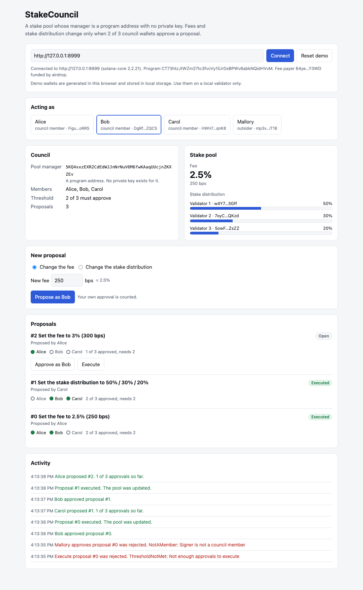

# StakeCouncil

**Council-controlled management for Solana stake pools. Fees and stake only move when 2 of 3 operators agree, and nobody holds the manager key.**

## Why

A stake pool holds other people's SOL, yet two keys decide everything about it. The *manager* sets the fees. The *staker* decides which validators receive the stake. Whoever holds those keys can raise fees or redirect stake alone, and one leaked key puts every depositor at risk.

StakeCouncil removes the single key. The pool's manager and staker authority is a program-derived address with no private key. The only way to use that authority is a proposal that a 2/3 supermajority of the council's wallets has approved on chain. Operators keep their own wallets. No secret is shared, stored on a server, or handed to one person.

It works with the SPL Stake Pool program as it is deployed today. An existing pool hands its manager authority to the council in one transaction, and from then on the stake pool program itself rejects the old key.

## How it works

1. **Propose.** A council member proposes a managerial action from their own wallet.
2. **Approve.** Other members approve. Outsiders and repeat approvals are rejected.
3. **Execute.** Once approvals reach the threshold, anyone can execute. The program calls the stake pool program, signing as the council address.

```
 alice              bob               anyone
   |                 |                  |
propose(action)   approve()          execute()
   |                 |                  |
   v                 v                  v
+--------------------------------+   approvals >= threshold?
| Proposal #1                    |      no  -> ThresholdNotMet
| action: SetFee 4% -> 2.5%      |      yes -> call the stake pool program
| approvals: alice, bob  (2/3)   |             as the council, mark executed
+--------------------------------+                 |
                                                   v
+-----------------------+  manager   +---------------------------+
| Council (PDA, no key) | <--------- | SPL stake pool             |
+-----------------------+   staker   +---------------------------+
```

The rules the program enforces:

- The threshold must be at least 2/3 of the members, and members must be unique.
- Only members can propose or approve, and each member counts once.
- A proposal executes once, and only after the threshold is met.
- The council can only sign instructions for the SPL Stake Pool program, and only with exactly the accounts that were approved.

## What the council controls

| Action | What it does | Status |
|---|---|---|
| `StakePoolInstruction` | Runs a manager or staker instruction on the SPL Stake Pool program, signed by the council address | Tested against the real program: take over a pool (`SetManager`), change its fee (`SetFee`), appoint the staker (`SetStaker`) |
| `SetFee` | Records the council's fee policy in `PoolConfig` | Tested |
| `SetStakeDistribution` | Records the share of stake each validator should receive | Tested |

Moving stake between validators (`IncreaseValidatorStake`, `DecreaseValidatorStakeWithReserve`) goes through the same `StakePoolInstruction` path, because the council is the pool's staker. Those two instructions are not covered by a test yet.

## Run it

```
pnpm install
anchor test
```

Needs Anchor 0.31.1 and the Solana CLI 2.x. `anchor test` builds the program, starts a local validator with the real SPL Stake Pool program loaded, and runs both suites:

```
real SPL Stake Pool: a council takes over a pool and runs it by 2-of-3 vote
      stake pool:  Jito4APyf642JPZPx3hGc6WWJ8zPKtRbRs4P815Awbb
      manager key: AKnL4NNf3DGWZJS6cPknBuEGnVsV4A4m5tgebLHaRSZ9 (a single keypair)
      epoch fee:   4/100
  ✔ starts with one key in charge of the pool
      rejected as expected: ThresholdNotMet
      pool manager is now the council PDA: 923adA8jYzxMVvvF2X1gq2E94RMyyMHmezYPk7p3sQLc
  ✔ takeover: the old manager and a 2-of-3 vote hand the pool to the council address
      stake pool program rejected the old key: Program log: Error: Wrong pool manager account.
  ✔ the old manager key can no longer change the fee
      rejected as expected: ThresholdNotMet
      rejected as expected: NotAMember
      stake pool next epoch fee: 250/10000 (was 4/100)
  ✔ fee change on the real pool: 1 of 3 is rejected, 2 of 3 goes through
      rejected as expected: AccountsMismatch
      pool staker is now the council PDA: 923adA8jYzxMVvvF2X1gq2E94RMyyMHmezYPk7p3sQLc
  ✔ staker authority: the council appoints who may move stake between validators

stake_council: a 2-of-3 council is the only manager of the stake pool
  ✔ creates the council; the pool manager is a PDA nobody holds a key for
  ✔ fee change: 1 of 3 approvals cannot execute, 2 of 3 can
  ✔ stake distribution: any 2 members can re-weight validators
  ✔ rejects outsiders and malformed actions at proposal time

9 passing
```

The wallet that runs the tests only pays fees. It is not a council member and cannot change the pool.

### What the real-pool test runs against

- **The program** is the SPL Stake Pool binary dumped from mainnet (`tests/fixtures/spl_stake_pool.so`) and loaded into the local validator at its real address.
- **The pool** is a copy of a mainnet stake pool account. Its manager and staker fields were replaced with a throwaway test key by `tests/fixtures/make-fixture.js`, so the test can play the pool's current operator and hand it over. The unmodified dump is kept next to it.
- Nothing is sent to mainnet or devnet. The program is not deployed to a public cluster.

## Demo UI

A single page that walks through the council flow in the browser, with no wallet extension.

```
anchor build
bash scripts/demo.sh
```

Open the printed URL (http://127.0.0.1:8080) and press Connect. Add `?autodemo=1` to the URL to play the whole flow automatically.

- Create a council of Alice, Bob and Carol with a 2 of 3 threshold.
- Switch between Alice, Bob, Carol and Mallory (an outsider), then propose a fee change or a new stake distribution.
- Approve and execute proposals, with approval dots and a status for each one.
- Rejections show the program's own error, for example `ThresholdNotMet` when executing with 1 of 3 approvals, or `NotAMember` when Mallory tries to approve.

The page uses throwaway keys generated in the browser, funded by airdrop on a local validator. It covers the council flow and the policy actions; taking over and managing a real stake pool is shown by the test suite above. It loads `@solana/web3.js` from a CDN, so it needs an internet connection.



## Accounts

| Account | Seeds | Holds |
|---|---|---|
| `Council` | `"council"`, creator | members, threshold, proposal counter |
| `Proposal` | `"proposal"`, council, id | the action, approval bitmap, executed flag |
| `PoolConfig` | `"pool"`, council | the council's recorded policy: fee and validator weights |

## Repo map

| Path | What |
|---|---|
| [`programs/stake_council/src/lib.rs`](programs/stake_council/src/lib.rs) | The program |
| [`tests/real_stake_pool.ts`](tests/real_stake_pool.ts) | Takeover and management of a real SPL stake pool |
| [`tests/stake_council.ts`](tests/stake_council.ts) | Council rules: thresholds, membership, validation |
| [`tests/fixtures/`](tests/fixtures) | Stake pool program binary, pool account copies, and the script that builds them |
| [`app/`](app) | The demo UI: a static page, no build step |
| [`scripts/demo.sh`](scripts/demo.sh) | Starts a local validator with the program and serves the UI |
| [`docs/claude-workspace.md`](docs/claude-workspace.md) | Notes on the Claude Code workspace this was built in |

## Status and limits

- Tested on a local validator only. Not deployed to devnet or mainnet, and not audited.
- Validator stake increase and decrease are supported by the generic instruction path but have no test.
- `SetFee` and `SetStakeDistribution` record policy in `PoolConfig`; they do not by themselves change a live pool. Use `StakePoolInstruction` for that.
- No member rotation: members and threshold are fixed when the council is created.
- Proposals do not expire and cannot be cancelled, so an approved proposal stays executable.
- Executed proposals are not closed, so their rent is not reclaimed.
- The pool fixture is tied to a throwaway test key, not to a pool you control. Pointing this at your own pool means running the takeover step with your real manager key.
